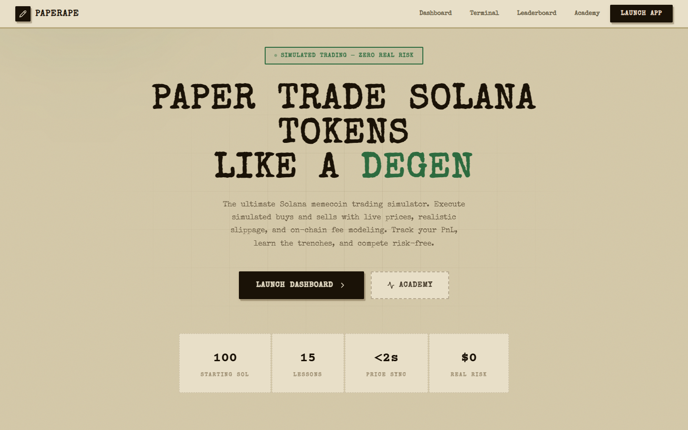
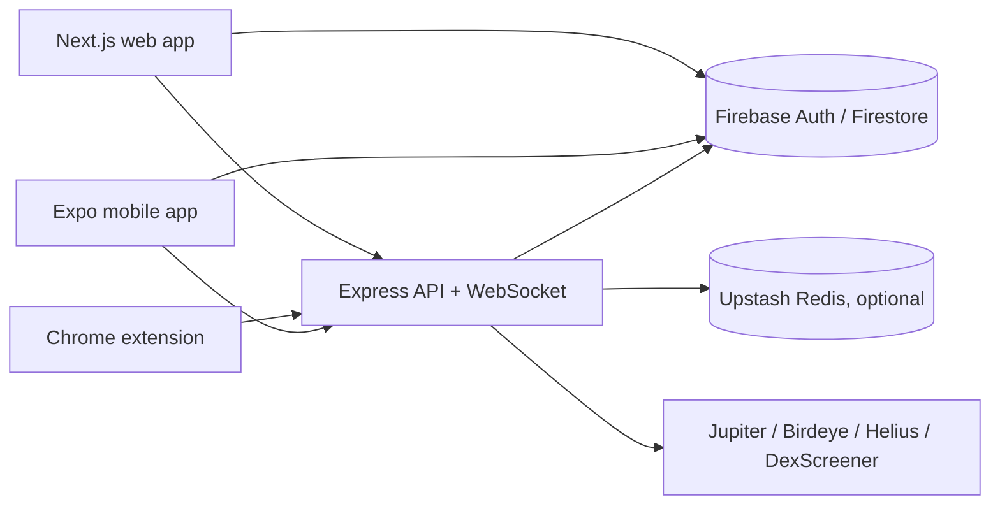

# Paper Trading Platform

[](https://github.com/omarpatel/paper-trading-platform/actions/workflows/ci.yml)
[](LICENSE)


Simulated trading for Solana tokens against live market prices, across web, browser extension and mobile.



## Overview

This monorepo contains a paper-trading system for Solana tokens. Users open and close simulated positions priced from live market data, so strategies can be practiced without real funds. An Express API with a WebSocket price stream is the core; a Next.js web app, a Chrome extension that overlays trading terminals, and an Expo mobile app all consume it. Firebase handles authentication and Firestore storage, and a shared TypeScript package keeps types and constants consistent across apps.

## Features

- Simulated buy/sell execution with multiple paper wallets per user
- Live token prices with fallbacks (Jupiter, Birdeye, Helius, DexScreener) and a WebSocket price stream
- Automated orders and DCA engine
- Rug-risk checks for tokens (RugCheck integration and heuristic rug detector)
- Wallet tracking, price alerts and leaderboard
- Learning curriculum / academy lessons
- Chrome extension with adapters that inject paper-trading controls into third-party trading terminals
- Optional Upstash Redis caching and rate limiting; `MOCK_MODE` to run the API without Firebase credentials

## Architecture



## Tech stack

- TypeScript, npm workspaces, Turborepo
- API: Express, ws, Firebase Admin, Upstash Redis, Vitest
- Web: Next.js, React, Firebase, lightweight-charts
- Extension: Vite, React, Tailwind CSS (Manifest V3)
- Mobile: Expo, React Native, Firebase
- Deployment configs: Render (`render.yaml`), Vercel (`vercel.json`), Firebase (`firestore.rules`)

## Getting started

Requires Node.js and npm (`npm@10.8.0` is pinned).

```bash
npm install
cp .env.example .env   # fill in values; see comments in the file
```

`MOCK_MODE=true` runs the API without Firebase Admin credentials. Market-data keys (`HELIUS_API_KEY`, `BIRDEYE_API_KEY`) and Upstash variables are optional. The mobile app reads Firebase config from `EXPO_PUBLIC_FIREBASE_*`.

```bash
npm run dev     # API, web app, extension watch build and shared package
npm run build
npm run lint
npm run test    # API unit tests
```

Per app:

```bash
npm run dev -w @papertrade/api         # API on PORT (default 3001)
npm run dev -w @papertrade/web         # web app on http://localhost:3000
npm run dev -w @papertrade/extension   # builds apps/extension/dist; load unpacked in Chrome
npm start -w papertrade-mobile         # Expo dev server
```

Build the shared package first (`npm run build -w @papertrade/shared`) when running an app on its own.

## Project structure

```
apps/
  api/         Express + WebSocket server, trading/pricing services, tests
  web/         Next.js web app
  extension/   Chrome extension (popup, content-script adapters)
  mobile/      Expo React Native app
packages/
  shared/      Shared types, constants and utilities
firestore.rules, firestore.indexes.json, firebase.json
render.yaml, vercel.json, turbo.json
```

## License

MIT. See [LICENSE](LICENSE).
